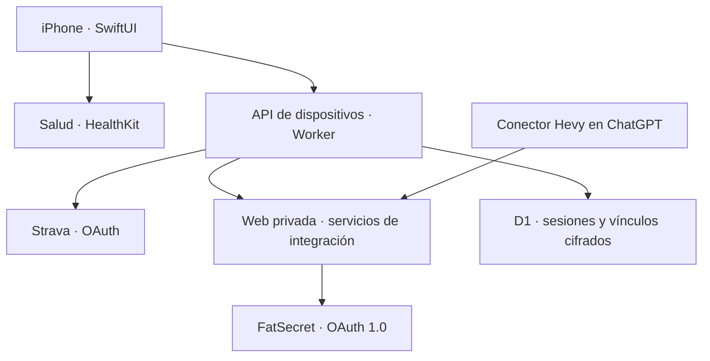

<p align="center">
  
</p>

<h1 align="center">Athlete Lab</h1>

<p align="center">
  <strong>Entrenamiento, nutrición y recuperación en una aplicación nativa para iPhone.</strong>
</p>

<p align="center">
  SwiftUI · HealthKit · OAuth · Cloudflare Workers · SQLite/D1 · WebCrypto
</p>

## El proyecto

Athlete Lab es un proyecto personal para reunir la planificación de triatlón, las actividades registradas y el diario nutricional en una misma experiencia. Su objetivo es reducir la consulta manual de varias aplicaciones y mantener una vista coherente del entrenamiento de cada día.

El proyecto combina una aplicación nativa, una API para dispositivos y una web privada. El principal reto técnico consiste en integrar fuentes con modelos de autorización diferentes, conservar la procedencia de los datos y ofrecer una interfaz útil incluso cuando un proveedor tarda o falla.

**Versión actual:** `0.21.0` · Desarrollo personal.

La implementación está orientada al uso individual. No constituye una publicación en App Store ni una solución multiusuario de producción.

## Capacidades actuales

| Área | Implementación |
| --- | --- |
| Planificación | Calendario diario y semanal con sesiones y descripción de ejercicios. Recursos JSON e iCalendar incluidos. |
| Actividad | Lectura de entrenamientos desde Salud: distancia, duración, energía y frecuencia cardiaca cuando están disponibles. |
| Detalle de sesión | Series temporales de pulso y recorridos cuando existen registros compatibles. |
| Nutrición | Diario de FatSecret por fecha, agrupado en desayuno, comida, cena y tentempiés. |
| Desglose nutricional | Subtotales por comida y alimentos desplegables con calorías, macronutrientes y descripción de la ración. |
| Objetivos | Anillo de energía y barras de macronutrientes respecto a metas configuradas por el usuario. |
| Hevy | Entrenamientos, ejercicios, series y cargas importados a la web mediante su conexión de ChatGPT. |
| Descanso | Lectura del sueño disponible en Salud y comparación con un objetivo personal. |
| Preferencias | Apariencia clara y oscura, perfil del atleta y próximas carreras. |
| Rendimiento | Caché local de días nutricionales y consultas específicas de comidas, independientes del resto de fuentes. |

## Arquitectura



### Aplicación iOS

SwiftUI presenta el estado observado del modelo principal. Los servicios encapsulan las consultas de Salud, el transporte HTTP, los detalles de actividad y la comunicación con el target de watchOS.

Las credenciales locales de sesión se almacenan en Keychain.

### API de dispositivos

Un Worker valida las sesiones por instalación, aplica límites de peticiones y devuelve contratos JSON para actividades y nutrición.

El servicio mantiene separados los permisos y estados de conexión de FatSecret, Hevy y Strava.

### Web privada

La web y sus rutas de servidor conservan las integraciones existentes con las fuentes.

Las credenciales de desarrollador de FatSecret permanecen en ese entorno. El servicio privado firma las peticiones y devuelve las respuestas necesarias para la autorización y la consulta del diario.

### Persistencia

D1 conserva sesiones, autorizaciones pendientes y datos de conexión. El cliente mantiene una caché de nutrición para reducir la espera al volver a fechas ya consultadas.

Los esquemas SQL y sus migraciones se incluyen con cada servicio.

## Decisiones de ingeniería

### 1. Mostrar los datos disponibles y actualizar después

Los días nutricionales consultados se guardan en una caché local limitada a **120 entradas**.

Al volver a una fecha, la aplicación muestra su última respuesta confirmada mientras consulta al proveedor:

- Una respuesta válida actualiza los alimentos guardados.
- Un día vacío confirmado sustituye el contenido anterior.
- Un error conserva el último contenido disponible y comunica el fallo.
- Desconectar FatSecret o completar una nueva autorización elimina la caché.

En iOS, el archivo utiliza protección de datos del sistema. La primera consulta de una fecha sigue necesitando una respuesta del proveedor.

### 2. Separar la navegación diaria de la sincronización completa

`POST /api/nutrition` consulta exclusivamente el diario de la fecha solicitada.

Cambiar de día no necesita descargar el historial de Hevy o Strava. La sincronización general puede omitir nutrición para evitar consultas duplicadas, mientras las lecturas de Salud se ejecutan en paralelo.

Una revisión incremental de solicitudes impide que una respuesta anterior sustituya a otra más reciente. La vista comprueba además que los datos correspondan al día seleccionado.

### 3. Adaptar la autorización a cada proveedor

| Fuente | Mecanismo | Consideraciones |
| --- | --- | --- |
| Salud | Permisos locales de HealthKit. | Depende de los datos compartidos y de las entregas de iOS. |
| FatSecret | OAuth 1.0 con autorización del diario personal. | El acceso al catálogo de alimentos no autoriza por sí mismo el diario de una cuenta. |
| Hevy | Importación mediante ChatGPT y código de vinculación para el dispositivo. | La app consulta lo importado al servidor; no establece una sesión OAuth directa con Hevy. |
| Strava | Flujo OAuth y renovación de tokens implementados. | Requiere credenciales, autorización y validación del despliegue utilizado. |

Los códigos de vinculación de Hevy:

- Caducan a las **24 horas**.
- Se almacenan mediante su hash.
- Se consumen con una operación de borrado y retorno del propietario.
- Tienen límites de intentos de canje.

Desconectar un dispositivo retira su vínculo sin borrar los entrenamientos almacenados en la web.

### 4. Agrupar actividades sin borrar los registros originales

Una capa de agrupación permite presentar sesiones relacionadas procedentes de varias fuentes y evita sumar dos veces la misma actividad en las vistas y los totales semanales.

Las pruebas incluyen registros parcialmente solapados, diferencias de duración y sesiones legítimamente distintas.

### 5. Distinguir un fallo de un día vacío

La API diferencia entre:

- Consulta completada.
- Fuente no conectada.
- Error de actualización.

Esta distinción permite conservar información útil sin interpretar una consulta fallida como ausencia de alimentos o entrenamientos.

## Seguridad y privacidad

- Tokens de sesión del dispositivo almacenados en **Keychain**.
- Tabla de sesiones del servidor basada en hashes, sin conservar los tokens originales.
- Autorizaciones y vínculos del servicio nativo cifrados con **AES-GCM**, con contexto asociado al propietario y al tipo de secreto.
- Credenciales administrativas y claves maestras configuradas exclusivamente en el servidor.
- Autorizaciones temporales de un solo uso.
- Límites de peticiones en operaciones sensibles.
- Consultas de Hevy restringidas al propietario vinculado al dispositivo.
- Respuestas de datos privados con política `no-store`.

Estas medidas forman parte de la implementación; no representan una auditoría de seguridad independiente. La configuración de acceso del despliegue privado también forma parte de la protección del sistema.

El repositorio no debe incluir tokens reales, códigos de vinculación, diarios exportados ni bases de datos de producción.

Los calendarios, objetivos y recursos personales deben revisarse antes de compartir el código con terceros.

## Organización del repositorio

| Ruta | Responsabilidad |
| --- | --- |
| `AthleteLab/AthleteLab.xcodeproj` | Proyecto Xcode y esquemas compartidos. |
| `AthleteLab/iOS/` | Interfaz SwiftUI, modelo, integración con Salud y transporte HTTP. |
| `AthleteLab/Watch/` | Target watchOS y componentes de comunicación con el iPhone. |
| `AthleteLab/Resources/` | Plan de entrenamiento JSON e iCalendar. |
| `AthleteLab/Tests/` | Pruebas de lógica Swift ejecutadas mediante scripts Python. |
| `AthleteLabNativeAPI/worker/` | Handler de la API de dispositivos. |
| `AthleteLabNativeAPI/tests/` | Pruebas del handler con SQLite y WebCrypto. |
| `AthleteLabWeb/app/` | Interfaz web y rutas privadas de integración. |
| `AthleteLabWeb/lib/` | Normalización de fuentes, autenticación e importaciones. |
| `docs/PUBLICACION_GITHUB.md` | Guía de publicación y mantenimiento del repositorio privado. |

La distribución conjunta conserva las rutas relativas utilizadas por las pruebas de integración.

Se excluyen los repositorios Git internos, dependencias instaladas, archivos de entorno y artefactos de compilación. La API utilizada por la app es el Worker; el antiguo servidor Python no forma parte de esta distribución.

## Ejecutar la aplicación

### Requisitos

- macOS con una versión de Xcode compatible con los SDK y el dispositivo utilizados.
- **iOS 17 o posterior**.
- **watchOS 10 o posterior** para el target de Watch.
- iPhone físico para comprobar Salud, autorizaciones y comportamiento del sistema.
- Acceso autorizado a los servicios desplegados.

### Abrir el proyecto

Desde la raíz del repositorio:

```bash
open AthleteLab/AthleteLab.xcodeproj
```

En Xcode:

1. Seleccionar el esquema `AthleteLab`.
2. Configurar el equipo de firma y el identificador de la aplicación en **Signing & Capabilities**.
3. Seleccionar el iPhone.
4. Ejecutar con **Run**.

### Comprobar la compilación sin firma

```bash
xcodebuild \
  -project AthleteLab/AthleteLab.xcodeproj \
  -scheme AthleteLab \
  -configuration Release \
  -sdk iphoneos \
  -derivedDataPath /tmp/athletelab-build \
  CODE_SIGNING_ALLOWED=NO build
```

Esta operación comprueba la compilación; no instala la app en el dispositivo.

El proyecto conserva identificadores del entorno personal. Cambiar el identificador de paquete o las capacidades puede requerir ajustes en la firma y los perfiles correspondientes.

### Configuración de los servicios

La app obtiene la dirección base del servicio desde `APIBaseURL` en:

```text
AthleteLab/iOS/Info.plist
```

Las URLs de integración también están ligadas al entorno personal. Para utilizar otro despliegue deben revisarse las direcciones, los callbacks y las restricciones de acceso.

La API nativa requiere:

| Configuración | Finalidad |
| --- | --- |
| `DB` | Binding de la base de datos D1. |
| `ENCRYPTION_KEY` | Clave de cifrado del servicio. |
| `ADMIN_TOKEN` | Autorización de operaciones administrativas. |
| `FATSECRET_PROXY_TOKEN` | Autorización entre servicios. |
| `FATSECRET_PROXY_GATE` | Acceso del servicio a la web privada. |

La web privada requiere su almacenamiento, `ATHLETE_SECRETS_KEY`, `NATIVE_FS_PROXY_TOKEN` y la configuración de cada proveedor.

**Los valores deben configurarse en el entorno de ejecución, nunca en Git.**

Los manifiestos de hosting y las migraciones se incluyen como referencia de la implementación. Clonar el repositorio no aprovisiona servicios ni replica bases de datos de producción.

## Pruebas y verificación

### Lógica del cliente

Desde la raíz del repositorio:

```bash
python3 AthleteLab/Tests/test_session_deduplication.py
python3 AthleteLab/Tests/test_website_mapping.py
python3 AthleteLab/Tests/test_nutrition.py
```

Estos scripts necesitan `swiftc` en el Mac. Extraen y compilan estructuras y funciones de la implementación para ejecutar comprobaciones sobre la lógica Swift real.

La cobertura incluye:

- Agrupación de actividades y prevención del doble cómputo.
- Fechas locales y conversiones de unidades.
- Normalización de registros.
- Sumas nutricionales y progreso respecto a objetivos.
- Persistencia y capacidad de la caché.
- Tratamiento de días vacíos.
- Eliminación de datos locales al desconectar.

### API de dispositivos

Con **Node.js 24 o posterior**:

```bash
node --test AthleteLabNativeAPI/tests/api.test.mjs
```

La suite utiliza el handler real, SQLite en memoria, WebCrypto y respuestas controladas de los proveedores.

Comprueba:

- Autenticación y caducidad de sesiones.
- Aislamiento entre instalaciones.
- Cifrado de datos de conexión.
- Rechazo de autorizaciones reutilizadas.
- Límites de intentos.
- Firma OAuth.
- Vinculación y desconexión de Hevy.
- Consulta independiente de nutrición.
- Diferenciación entre errores y respuestas vacías válidas.

### Validación de referencia

Para la versión `0.21.0`:

| Comprobación | Resultado |
| --- | --- |
| Suite de API | 32 pruebas superadas. |
| Scripts de lógica Swift | Superados. |
| Compilación Release para iPhone sin firma | Completada. |
| Lectura real de la importación de Hevy | 259 registros recuperados con detalle. |

La cifra de registros corresponde al conjunto personal utilizado para verificar la integración; no representa una prueba de carga.

La compilación y las pruebas automatizadas no sustituyen la comprobación en un iPhone físico. Los permisos de Salud, las autorizaciones finales, las restricciones de iOS y los cambios de los proveedores requieren validación adicional.

## Actualización de datos

- La app consulta al activarse y realiza una sincronización general aproximadamente cada **dos minutos** mientras permanece en primer plano. La duración de las operaciones puede ampliar ese intervalo.
- Cambiar de fecha o actualizar Nutrición manualmente utiliza la consulta específica del diario.
- Salud utiliza consultas locales y avisos del sistema; iOS controla cuándo entrega nuevos datos.
- Hevy refleja la última importación disponible en la web privada.
- No se garantiza una frecuencia de sincronización cuando la app está cerrada.

## Próximos pasos

- [ ] Asegurar una importación periódica y observable de Hevy.
- [ ] Completar la validación de Strava en el dispositivo y el entorno definitivo.
- [ ] Ampliar la cobertura de interfaz y las comprobaciones en dispositivos físicos.
- [ ] Consolidar y validar el flujo en directo de Apple Watch.
- [ ] Diseñar la sincronización automática entre dispositivos.
- [ ] Desarrollar y validar métricas de recuperación y carga con criterios explícitos.
- [ ] Reducir el acoplamiento entre URLs, identidad y despliegue personal.
- [ ] Automatizar compilación y pruebas mediante integración continua.

## Autor

Proyecto personal de **Marc**, estudiante del Doble Grado en Ingeniería Informática y ADE en la **Universitat Politècnica de València**.

## Uso y licencias

El repositorio se mantiene inicialmente privado para desarrollo y revisión técnica.

Este README no concede una licencia de distribución pública. Los componentes de terceros conservan sus licencias y avisos correspondientes.
